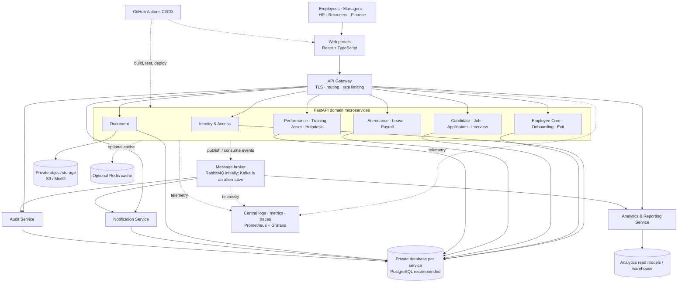

# **HR Management System – Complete Module Breakdown & Microservices Architecture**

We will divide the system into three parts:

1. **Module Responsibilities:** What each module does and what operations it handles.
2. **Microservices Separation:** How the modules should be divided into independent backend services.
3. **Service Communication:** How these microservices communicate with each other.

The objective is to cover the complete employee lifecycle:

**Recruitment → Selection → Onboarding → Employee Management → Attendance → Payroll → Performance → Exit**

# **Part 1: Detailed module responsibilities**

## **A. Recruitment Management**

These modules handle the process of finding, evaluating and hiring candidates.

### **1. HR Profile Management**

**Priority: High**

Purpose: Manage HR personnel profiles and their organizational information.

Responsibilities:

- Create and manage HR profiles.
- Update HR personal and professional information.
- Manage HR employee IDs.
- Assign HR personnel to departments.
- Assign recruitment responsibilities.
- Manage HR contact information.
- Track HR account status (Active/Inactive).
- Assign HR personnel to job openings.
- View HR activity and assigned responsibilities.

Example: An HR manager can assign a recruiter to handle Python Developer recruitment.

### **2. Candidate Management**

**Priority: High**

Purpose: Maintain a centralized database of candidates applying for jobs.

Responsibilities:

- Register new candidates.
- Create and update candidate profiles.
- Store personal and contact information.
- Upload and manage resumes.
- Track educational qualifications.
- Record technical and professional skills.
- Maintain work experience.
- Manage candidate status.
- Search and filter candidates.
- Maintain candidate history.
- Identify duplicate candidate profiles.
- Track candidate source (LinkedIn, Naukri, referral, company website).

Example: HR can search for candidates with Python, Django and PostgreSQL skills.

### **3. Job Description Management**

**Priority: High**

Purpose: Create, manage and publish job openings.

Responsibilities:

- Create new job openings.
- Define job titles and descriptions.
- Specify required technical skills.
- Define educational qualifications.
- Specify experience requirements.
- Define salary ranges.
- Assign departments and hiring managers.
- Set job locations (Remote, Hybrid, On-site).
- Set application deadlines.
- Publish and unpublish job openings.
- Manage job status (Draft, Open, Closed, On Hold).
- Track the number of applications per job.

Example: HR creates a Python Full Stack Developer opening requiring 0–2 years of experience.

### **4. Job Application Management**

**Priority: High**

Purpose: Manage applications submitted by candidates for different job openings.

Responsibilities:

- Allow candidates to apply for jobs.
- Link candidates with job openings.
- Receive and store applications.
- Upload resumes and supporting documents.
- Track application status.
- Perform initial application screening.
- Shortlist or reject candidates.
- Assign applications to recruiters.
- Maintain application history.
- Prevent duplicate applications where appropriate.
- Move shortlisted applications to interview rounds.
- Track the recruitment pipeline.

Suggested application statuses:

`Applied → Screening → Shortlisted → Interview → Selected / Rejected`

Example: A candidate applies for a Python Developer position, and HR moves the application to the screening stage.

### **5. Interview Management**

**Priority: High**

Purpose: Organize and manage candidate interviews throughout the recruitment process.

Responsibilities:

- Create interview rounds.
- Schedule interviews.
- Assign interviewers.
- Manage interview panels.
- Define interview types (Technical, HR, Managerial).
- Send interview invitations.
- Reschedule or cancel interviews.
- Record interviewer feedback.
- Maintain interview evaluation forms.
- Rate candidates based on predefined criteria.
- Record interview results.
- Move candidates to subsequent rounds.
- Mark candidates as Selected or Rejected.

Example:

| Round   | Interview type | Responsible           |
| ------- | -------------- | --------------------- |
| Round 1 | Technical      | Technical interviewer |
| Round 2 | Managerial     | Team manager          |
| Round 3 | HR             | HR recruiter          |

## **B. Employee Lifecycle Management**

These modules handle the transition from selected candidate to employee and manage the employee's entire journey.

### **6. Employee Management**

**Priority: High**

Purpose: Maintain complete employee information throughout their employment.

Responsibilities:

- Create employee profiles.
- Generate unique employee IDs.
- Maintain personal information.
- Maintain professional information.
- Assign departments and designations.
- Assign reporting managers.
- Maintain employment history.
- Manage employment types (Full-time, Part-time, Contract).
- Track joining dates.
- Update employee information.
- Manage employee transfers.
- Track promotions and designation changes.
- Manage employee status (Active, Inactive, Suspended).
- View employee organizational hierarchy.

Example: When a candidate joins the company, their employee profile is created with an employee ID.

### **7. Onboarding Management**

**Priority: High**

Purpose: Manage all activities required when a selected candidate joins the organization.

Responsibilities:

- Convert selected candidates into employees.
- Generate onboarding checklists.
- Collect joining documents.
- Verify submitted documents.
- Generate offer and appointment letters.
- Record offer acceptance.
- Schedule joining activities.
- Assign departments and reporting managers.
- Create employee accounts.
- Coordinate IT and HR onboarding tasks.
- Allocate company assets.
- Track onboarding completion.
- Manage probation periods.

Example:

When a candidate accepts an offer:

1. HR initiates onboarding.
2. Candidate submits required documents.
3. HR verifies documents.
4. Employee ID is generated.
5. Employee account is created.
6. IT allocates a laptop.
7. Employee onboarding is completed.

### **8. Attendance Management**

**Priority: High**

Purpose: Track employee attendance and working hours.

Responsibilities:

- Record employee check-in and check-out.
- Track daily attendance.
- Calculate working hours.
- Track late arrivals.
- Track early departures.
- Manage overtime.
- Record work-from-home attendance.
- Manage shift schedules.
- Track missing attendance records.
- Allow attendance correction requests.
- Maintain attendance history.
- Generate attendance reports.

Example: An employee checks in at 9:30 AM and checks out at 6:30 PM. The system records the attendance and calculates the working duration.

### **9. Leave Management**

**Priority: High**

Purpose: Manage employee leave requests, approvals and balances.

Responsibilities:

- Define leave types.
- Configure leave policies.
- Maintain employee leave balances.
- Allow employees to apply for leave.
- Approve or reject leave requests.
- Assign leave approvers.
- Manage half-day leaves.
- Manage multiple-day leaves.
- Track sick and casual leaves.
- Manage public holidays.
- Handle leave cancellations.
- Maintain leave history.
- Generate leave reports.

Example:

An employee applies for three days of casual leave. Their manager receives a notification and approves or rejects the request.

### **10. Payroll Management**

**Priority: High**

Purpose: Calculate and manage employee salaries and payroll records.

Responsibilities:

- Maintain employee salary structures.
- Define basic salary and allowances.
- Configure salary components.
- Calculate monthly salaries.
- Calculate eligible deductions.
- Process overtime payments.
- Manage bonuses and incentives.
- Calculate applicable tax and statutory deductions.
- Generate monthly payroll.
- Generate employee payslips.
- Maintain payroll history.
- Manage payroll approval workflows.
- Generate payroll reports.

Example:

The system calculates an employee's monthly gross salary, applicable deductions and net payable salary.

Note: Actual payroll calculations should follow applicable Indian tax, PF, ESI and other statutory rules, based on employee eligibility and current regulations.

## **C. Employee Development Management**

### **11. Performance Management**

**Priority: Medium**

Purpose: Evaluate employee performance and track professional growth.

Responsibilities:

- Create performance evaluation cycles.
- Define employee goals and KPIs.
- Assign goals to employees.
- Track goal completion.
- Conduct periodic performance reviews.
- Allow employee self-assessments.
- Collect manager feedback.
- Record peer feedback.
- Calculate performance ratings.
- Maintain performance history.
- Identify high-performing employees.
- Track promotion recommendations.
- Generate performance reports.

Example: A manager evaluates an employee based on productivity, teamwork, technical skills and goal completion.

### **12. Training Management**

**Priority: Medium**

Purpose: Manage employee learning, training and skill development.

Responsibilities:

- Create training programs.
- Manage training categories.
- Assign training to employees.
- Schedule training sessions.
- Assign trainers.
- Manage internal and external courses.
- Track training participation.
- Monitor course completion.
- Conduct skill assessments.
- Manage certifications.
- Track certification expiry dates.
- Collect training feedback.
- Generate training reports.

Example: HR assigns an AWS training program to newly recruited DevOps engineers.

### **13. Asset Management**

**Priority: Medium**

Purpose: Track company assets assigned to employees.

Responsibilities:

- Register company assets.
- Generate unique asset IDs.
- Maintain asset categories.
- Track asset availability.
- Assign assets to employees.
- Record asset allocation dates.
- Track asset return dates.
- Maintain asset condition.
- Manage repair and maintenance records.
- Track damaged or lost assets.
- Maintain asset allocation history.
- Generate asset reports.

Example: During onboarding, IT assigns a laptop, charger and access card to an employee.

### **14. Document Management**

**Priority: Medium**

Purpose: Centralize and manage employee and recruitment-related documents.

Responsibilities:

- Upload employee documents.
- Store resumes and candidate documents.
- Store offer letters.
- Store appointment letters.
- Manage employment contracts.
- Store identity and address documents.
- Store educational certificates.
- Manage salary slips.
- Maintain document versions.
- Track document verification status.
- Track document expiry dates.
- Control document access.
- Download and view documents.
- Maintain document history.

Example: HR uploads an employee's offer letter and educational certificates to their document repository.

## **D. Employee Exit Management**

### **15. Exit Management**

**Priority: Medium**

Purpose: Manage employee resignation and separation processes.

Responsibilities:

- Allow employees to submit resignation requests.
- Record resignation reasons.
- Approve or reject resignation requests.
- Calculate notice periods.
- Track last working dates.
- Schedule exit interviews.
- Manage knowledge transfer.
- Track pending tasks.
- Coordinate asset returns.
- Revoke employee system access.
- Manage clearance approvals.
- Calculate full and final settlements.
- Generate experience letters.
- Generate relieving letters.
- Update employee status to Resigned.
- Maintain employee exit history.

Example: An employee submits a resignation request, and HR coordinates manager approval, laptop return and final settlement.

## **E. System Administration & Communication**

### **16. Notifications**

**Priority: High**

Purpose: Send automated notifications and reminders across the HRMS.

Responsibilities:

- Send email notifications.
- Send in-app notifications.
- Send interview invitations.
- Notify candidates about application updates.
- Notify employees about leave approvals.
- Send attendance reminders.
- Notify HR about pending tasks.
- Send payroll notifications.
- Send onboarding reminders.
- Notify employees about company announcements.
- Manage notification templates.
- Track notification delivery status.
- Manage notification preferences.

Example: When an interview is scheduled, the candidate and interviewer receive notifications.

### **17. Reports & Analytics**

**Priority: High**

Purpose: Provide management insights and reports about organizational activities.

Responsibilities:

- Generate employee reports.
- Generate recruitment reports.
- Track hiring statistics.
- Track employee turnover.
- Generate attendance reports.
- Generate leave reports.
- Generate payroll reports.
- Track department-wise employee counts.
- Generate performance reports.
- Track training completion.
- Generate asset utilization reports.
- Display HR dashboards.
- Export reports to CSV, Excel or PDF.
- Provide date-wise and department-wise filters.

Example: HR can view the total number of employees hired, rejected candidates and open positions during a particular month.

### **18. Role & Permission Management**

**Priority: High**

Purpose: Control system access based on user roles and permissions.

Responsibilities:

- Create and manage user accounts.
- Define system roles.
- Assign permissions to roles.
- Assign roles to users.
- Manage authentication.
- Manage login and logout.
- Support password changes and resets.
- Manage account activation and deactivation.
- Restrict access to sensitive information.
- Implement role-based access control (RBAC).
- Manage session security.
- Support multi-factor authentication where required.

Suggested roles:

| Role               | Access                                      |
| ------------------ | ------------------------------------------- |
| Super Admin        | Complete system access                      |
| HR Admin           | HR operations and employee management       |
| Recruiter          | Candidates, jobs and interviews             |
| Hiring Manager     | Assigned recruitment and team               |
| Department Manager | Team attendance, leave and performance      |
| Employee           | Own profile, leave, attendance and payslips |
| Finance/Payroll    | Payroll operations                          |

### **19. Audit Logs**

**Priority: Medium**

Purpose: Maintain a record of important actions performed inside the system.

Responsibilities:

- Track user login activities.
- Record data creation.
- Record data updates.
- Record data deletion.
- Track permission changes.
- Track salary modifications.
- Track employee profile changes.
- Record approval and rejection activities.
- Store timestamps.
- Store user IDs.
- Track the source of actions where appropriate.
- Provide searchable audit history.
- Prevent unauthorized modification of audit records.

Example:

If an HR administrator changes an employee's salary, the system records:

- Who made the change.
- What was changed.
- Previous value.
- New value.
- Date and time.

### **20. Employee Helpdesk**

**Priority: Medium**

Purpose: Provide a centralized platform for employees to raise HR and IT-related requests.

Responsibilities:

- Allow employees to create support tickets.
- Categorize employee queries.
- Assign tickets to HR or IT teams.
- Set ticket priorities.
- Track ticket status.
- Add comments and attachments.
- Assign support agents.
- Manage ticket escalation.
- Set response and resolution targets.
- Notify employees about ticket updates.
- Collect employee feedback.
- Generate ticket resolution reports.

Example:

An employee raises a ticket requesting an update to their bank account information. HR receives the ticket and processes the request.

# **Part 2: Microservices Architecture**

Now let's separate all 20 modules into independent microservices.

**Important architectural decision:** A module and a microservice are not necessarily the same thing. Multiple closely related modules can belong to one microservice. This avoids creating too many small services and makes the system easier to maintain.

## **1. Microservices separation table**

| No. | Microservice                  | Modules covered                            |
| --- | ----------------------------- | ------------------------------------------ |
| 1   | Identity & Access Service     | Role & Permission Management               |
| 2   | Employee Core Service         | HR Profile Management, Employee Management |
| 3   | Candidate Service             | Candidate Management                       |
| 4   | Job Service                   | Job Description Management                 |
| 5   | Application Service           | Job Application Management                 |
| 6   | Interview Service             | Interview Management                       |
| 7   | Onboarding Service            | Onboarding Management                      |
| 8   | Attendance Service            | Attendance Management                      |
| 9   | Leave Service                 | Leave Management                           |
| 10  | Payroll Service               | Payroll Management                         |
| 11  | Performance Service           | Performance Management                     |
| 12  | Training Service              | Training Management                        |
| 13  | Asset Service                 | Asset Management                           |
| 14  | Document Service              | Document Management                        |
| 15  | Exit Management Service       | Exit Management                            |
| 16  | Notification Service          | Notifications                              |
| 17  | Analytics & Reporting Service | Reports & Analytics                        |
| 18  | Audit Service                 | Audit Logs                                 |
| 19  | Helpdesk Service              | Employee Helpdesk                          |

## **2. Detailed microservice responsibilities**

This table explains what each backend service should own.

| Microservice              | Main responsibilities                                                                                                            |
| ------------------------- | -------------------------------------------------------------------------------------------------------------------------------- |
| **Identity & Access**     | User registration, login, authentication, JWT tokens, password reset, RBAC, permissions, session management                      |
| **Employee Core**         | HR profiles, employee profiles, employee IDs, departments, designations, managers, employment history, employee status           |
| **Candidate**             | Candidate registration, personal details, resumes, qualifications, skills, experience, candidate search                          |
| **Job**                   | Job creation, job descriptions, required skills, salary range, job publishing, job status, hiring requirements                   |
| **Application**           | Job applications, application status, resume submission, application screening, shortlisting, rejection, recruitment pipeline    |
| **Interview**             | Interview rounds, scheduling, interviewer assignments, feedback, evaluation scores, interview results                            |
| **Onboarding**            | Candidate-to-employee conversion, joining checklists, document verification, offer acceptance, joining tasks, probation tracking |
| **Attendance**            | Check-in/check-out, working hours, shifts, overtime, late arrivals, attendance corrections                                       |
| **Leave**                 | Leave policies, leave applications, approval workflows, leave balance, holiday calendar                                          |
| **Payroll**               | Salary structures, allowances, deductions, payroll processing, payslips, payroll history                                         |
| **Performance**           | Goals, KPIs, performance reviews, self-assessments, manager feedback, ratings                                                    |
| **Training**              | Training programs, course assignments, trainers, skill assessments, certifications, training progress                            |
| **Asset**                 | Asset registration, asset allocation, asset returns, maintenance, asset history                                                  |
| **Document**              | Document uploads, storage metadata, verification, version management, access control, expiry tracking                            |
| **Exit Management**       | Resignation, notice period, exit interviews, clearance, asset returns coordination, final settlement workflow                    |
| **Notification**          | Email, in-app notifications, templates, reminders, delivery status                                                               |
| **Analytics & Reporting** | Recruitment metrics, employee reports, attendance statistics, payroll reports, dashboards, exports                               |
| **Audit**                 | Activity tracking, user actions, record changes, timestamps, previous and new values                                             |
| **Helpdesk**              | Support tickets, categories, assignments, priorities, comments, escalation, resolution tracking                                  |

## **3. Microservice ownership and database separation**

Each microservice should own its business data and database.

For example:

| Microservice          | Suggested database          | Example tables                                           |
| --------------------- | --------------------------- | -------------------------------------------------------- |
| Identity & Access     | PostgreSQL                  | users, roles, permissions, user_roles                    |
| Employee Core         | PostgreSQL                  | employees, hr_profiles, departments, designations        |
| Candidate             | PostgreSQL                  | candidates, candidate_skills, candidate_experience       |
| Job                   | PostgreSQL                  | jobs, job_skills, job_requirements                       |
| Application           | PostgreSQL                  | applications, application_status_history                 |
| Interview             | PostgreSQL                  | interviews, interview_rounds, interview_feedback         |
| Onboarding            | PostgreSQL                  | onboarding_tasks, onboarding_checklists, joining_records |
| Attendance            | PostgreSQL                  | attendance, shifts, attendance_corrections               |
| Leave                 | PostgreSQL                  | leave_requests, leave_types, leave_balances, holidays    |
| Payroll               | PostgreSQL                  | salary_structures, payroll_runs, payslips, deductions    |
| Performance           | PostgreSQL                  | goals, reviews, performance_ratings                      |
| Training              | PostgreSQL                  | courses, training_assignments, certifications            |
| Asset                 | PostgreSQL                  | assets, asset_assignments, maintenance_records           |
| Document              | PostgreSQL + Object Storage | document_metadata, document_versions                     |
| Exit Management       | PostgreSQL                  | resignations, exit_clearances, settlements               |
| Notification          | PostgreSQL                  | notifications, templates, delivery_logs                  |
| Analytics & Reporting | PostgreSQL / Data Warehouse | reporting datasets, aggregated metrics                   |
| Audit                 | PostgreSQL                  | audit_events, activity_history                           |
| Helpdesk              | PostgreSQL                  | tickets, ticket_comments, ticket_assignments             |

These are suggested database designs, not mandatory technologies. Each service can use a database suited to its workload. Object storage should hold actual files; the Document Service database stores their metadata and access information.

**Important database rule:** One microservice should not directly access another microservice's database. Services communicate through APIs or events.

# **Part 3: How microservices communicate**

A real HRMS requires communication between services. Consider the following example.

## **Example 1: Recruitment to employee onboarding**

When a candidate gets selected, multiple services need to work together.

**1. Job Service**

Creates and publishes job openings

**2. Candidate Service**

Stores candidate information

**3. Application Service**

Manages applications and screening

**4. Interview Service**

Schedules interviews and records feedback

**5. Application Service**

Marks the candidate as selected

**6. Onboarding Service**

Starts joining and document verification

**7. Employee Core Service**

Creates the employee profile and employee ID

**8. Identity & Access Service**

Creates or activates employee login access

The Notification Service can also send updates at different stages.

## **Example 2: Employee leave and attendance workflow**

1. Employee submits a leave request.
2. Leave Service receives the request.
3. Manager receives a notification.
4. Manager approves the leave.
5. Leave balance is updated.
6. Leave Service publishes an approval event.
7. Attendance Service uses the approved leave information when processing attendance.
8. Notification Service informs the employee.

## **Example 3: Payroll workflow**

1. Attendance Service provides attendance summaries.
2. Leave Service provides approved leave information.
3. Employee Core Service provides employee and employment information.
4. Payroll Service retrieves the required information through APIs or published events.
5. Payroll calculates salary and applicable deductions.
6. Payroll generates payslips.
7. Notification Service informs employees that their payslips are available.

**Architecture recommendation:** Use REST APIs for synchronous operations and RabbitMQ or Kafka for asynchronous events. For example, `EmployeeCreated`, `LeaveApproved`, `CandidateSelected` and `PayrollProcessed`.

# **Part 4: Overall system architecture**

The diagram shows the recommended logical architecture. Service families are grouped for readability; each named service remains an independently deployable boundary with ownership of its own data.

### Architectural decisions and alternatives

| Concern | Recommended choice | Alternatives and rationale |
| --- | --- | --- |
| Service boundaries | Keep the 19 services from Part 2, grouped by domain in the diagram. | Avoid splitting every feature into its own tiny service. Start with the planned phases and extract independently deployable services as operational needs justify them. |
| Synchronous APIs | REST with OpenAPI; route external client traffic through the API Gateway. | GraphQL can be considered if portal aggregation becomes a demonstrated need. Internal services must still enforce authorization. |
| Asynchronous messaging | RabbitMQ for the initial event-driven workflows. | Kafka is a valid alternative for high-throughput, replay-heavy event streams, but adds operational complexity. Use versioned events and idempotent consumers; use a transactional outbox to avoid losing events when a database write succeeds but message publication fails. |
| Data ownership | PostgreSQL per service boundary; no cross-service database reads or shared tables. | Databases may be physically co-hosted at first, but each service must retain logical ownership and access boundaries. |
| Documents | Store file bytes in private S3-compatible object storage and metadata in the Document Service database. | MinIO supports self-hosting; use a managed object store when available. Enforce authorization, encryption, malware scanning, and short-lived download links. |
| Reporting | Build reporting read models from events in the Analytics Service. | Add a dedicated warehouse as reporting volume and analytical needs grow; do not query operational service databases directly. |
| Cache | Add Redis only for measured caching or short-lived coordination needs. | Omit it initially when there is no demonstrated need; it is not the source of truth for business records. |
| Deployment | Docker Compose for local development and early environments; consider Kubernetes when scale or availability requirements justify it. | Do not introduce cluster orchestration before the team can operate it effectively. |
| Identity and authorization | Centralize authentication and identity; validate tokens at the gateway and enforce role/permission checks in every service. | OAuth 2.0 / OpenID Connect can be provided by a managed identity provider rather than built in-house. |

### Key improvements for a production-ready design

- Keep payroll, employee records, and uploaded documents behind least-privilege access controls; encrypt data in transit and at rest, and audit sensitive reads and changes.
- Add an outbox and idempotent event handling for workflows such as onboarding, leave approval, and payroll processing so retries do not lose events or duplicate business actions.
- Make analytics consume its own event-fed read models; keep reporting workloads away from operational databases and redact or aggregate sensitive fields.
- Add centralized structured logs, metrics, traces, health checks, and alerts before expanding the number of deployed services.
- Define API and event versioning, retention and backup policies, and secrets management as part of deployment readiness.

## **Recommended technology stack**

Since we're building this as a Python-based project, this is the stack we would choose:

| Layer             | Technology                                 |
| ----------------- | ------------------------------------------ |
| Frontend          | React.js, TypeScript                       |
| Backend           | Python, FastAPI                            |
| API Gateway       | Nginx / Traefik                            |
| Database          | PostgreSQL                                 |
| ORM               | SQLAlchemy                                 |
| Authentication    | JWT, OAuth 2.0                             |
| Message Broker    | RabbitMQ                                   |
| Caching           | Redis                                      |
| File Storage      | AWS S3 / MinIO                             |
| Containerization  | Docker                                     |
| Orchestration     | Docker Compose initially, Kubernetes later |
| CI/CD             | GitHub Actions                             |
| Monitoring        | Prometheus + Grafana                       |
| API Documentation | Swagger / OpenAPI                          |
| Version Control   | Git + GitHub                               |

## **Part 5: Suggested development order**

We won't develop all 19 microservices simultaneously.

| Phase   | Services                               | Objective                              |
| ------- | -------------------------------------- | -------------------------------------- |
| Phase 1 | Identity, Employee Core                | Authentication and employee foundation |
| Phase 2 | Candidate, Job, Application, Interview | Complete recruitment                   |
| Phase 3 | Onboarding, Document, Asset            | Employee joining process               |
| Phase 4 | Attendance, Leave, Payroll             | Daily HR operations                    |
| Phase 5 | Performance, Training, Exit            | Employee lifecycle                     |
| Phase 6 | Notifications, Audit, Helpdesk         | System operations                      |
| Phase 7 | Analytics & Reporting                  | Management dashboards                  |

Complete Phase 1 and Phase 2 before moving forward. This gives us a working recruitment system and a strong foundation for the remaining services.

**Three important architecture rules:**

1. Each service owns its database. Avoid sharing database tables between services.
2. Use event-driven communication for business events, especially when multiple services need to react to an action.
3. Implement centralized authentication, but enforce authorization inside each service as well.

## **Final architecture deliverables**

For this project, we would maintain these design documents:

- System Architecture Diagram
- Microservices Architecture Diagram
- Database ER Diagrams (separately for each service)
- API Endpoint Documentation
- Service Communication Diagram
- User Roles & Permission Matrix
- Recruitment and Employee Lifecycle Workflows

The next logical step is to create the **complete database schema and API endpoint specification for all 19 microservices**, including table relationships, request/response structures and service-to-service communication.