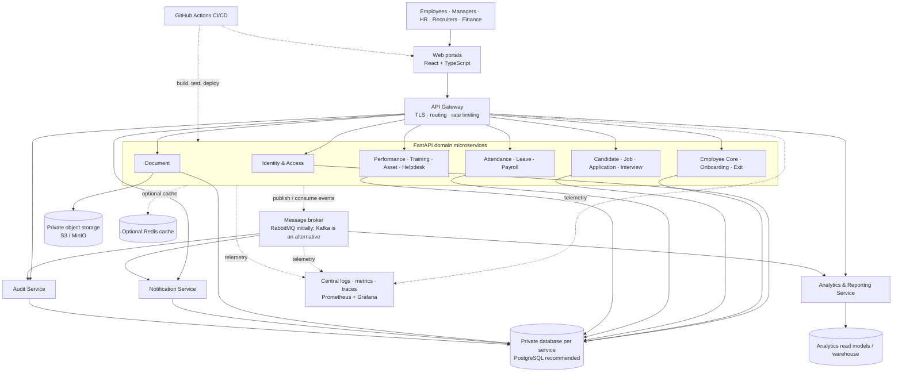

# HRMS System Architecture

This document describes the recommended logical architecture for the HR Management System. Service families are grouped for readability; each named service remains an independently deployable boundary with ownership of its own data.

## System diagram

## Architectural decisions and alternatives

| Concern | Recommended choice | Alternatives and rationale |
| --- | --- | --- |
| Service boundaries | Keep the 19 services from Part 2, grouped by domain in the diagram. | Avoid splitting every feature into its own tiny service. Start with the planned phases and extract independently deployable services as operational needs justify them. |
| Synchronous APIs | REST with OpenAPI; route external client traffic through the API Gateway. | GraphQL can be considered if portal aggregation becomes a demonstrated need. Internal services must still enforce authorization. |
| Asynchronous messaging | RabbitMQ for the initial event-driven workflows. | Kafka is a valid alternative for high-throughput, replay-heavy event streams, but adds operational complexity. Use versioned events and idempotent consumers; use a transactional outbox to avoid losing events when a database write succeeds but message publication fails. |
| Data ownership | PostgreSQL per service boundary; no cross-service database reads or shared tables. | Databases may be physically co-hosted at first, but each service must retain logical ownership and access boundaries. |
| Documents | Store file bytes in private S3-compatible object storage and metadata in the Document Service database. | MinIO supports self-hosting; use a managed object store when available. Enforce authorization, encryption, malware scanning, and short-lived download links. |
| Reporting | Build reporting read models from events in the Analytics Service. | Add a dedicated warehouse as reporting volume and analytical needs grow; do not query operational service databases directly. |
| Cache | Add Redis only for measured caching or short-lived coordination needs. | Omit it initially when there is no demonstrated need; it is not the source of truth for business records. |
| Deployment | Docker Compose for local development and early environments; consider Kubernetes when scale or availability requirements justify it. | Do not introduce cluster orchestration before the team can operate it effectively. |
| Identity and authorization | Centralize authentication and identity; validate tokens at the gateway and enforce role/permission checks in every service. | OAuth 2.0 / OpenID Connect can be provided by a managed identity provider rather than built in-house. |

## Key improvements for a production-ready design

- Keep payroll, employee records, and uploaded documents behind least-privilege access controls; encrypt data in transit and at rest, and audit sensitive reads and changes.
- Add an outbox and idempotent event handling for workflows such as onboarding, leave approval, and payroll processing so retries do not lose events or duplicate business actions.
- Make analytics consume its own event-fed read models; keep reporting workloads away from operational databases and redact or aggregate sensitive fields.
- Add centralized structured logs, metrics, traces, health checks, and alerts before expanding the number of deployed services.
- Define API and event versioning, retention and backup policies, and secrets management as part of deployment readiness.
